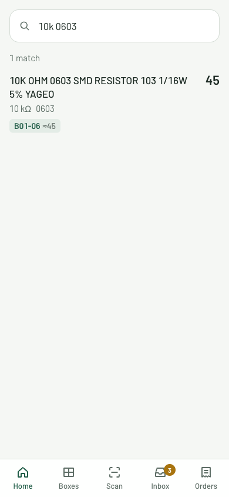
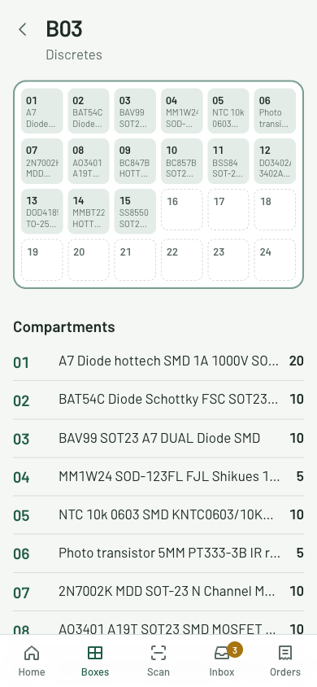
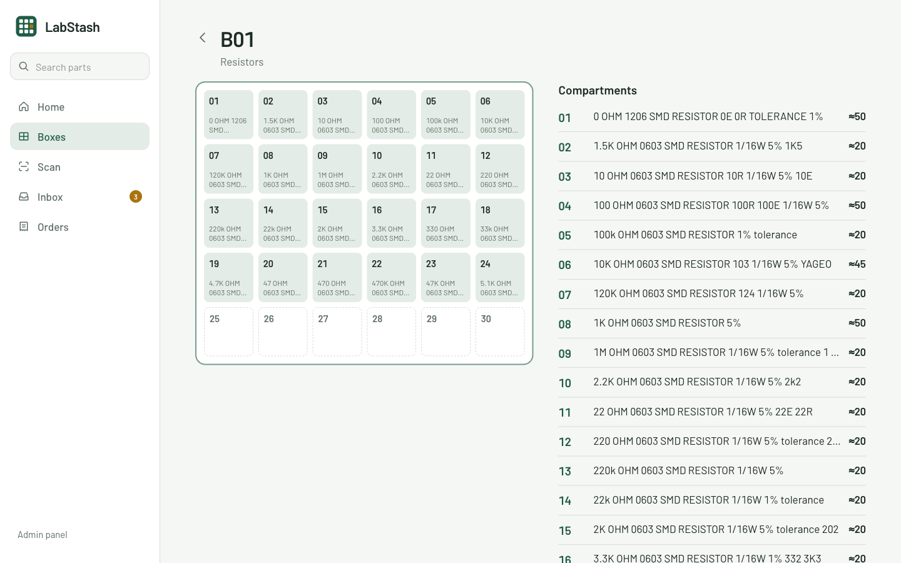

# LabStash

Self-hosted inventory for an electronics workbench. LabStash answers three questions about your parts: **do I have it, where is it, and what do I need to reorder?**

It tracks every part down to the box and compartment it sits in, keeps an append-only ledger of every stock change, imports orders straight from Indian component stores, and gives you a mobile-first app for the moments you're standing at the shelf with a reel in your hand.

<p align="center">
  
  &nbsp;
  
</p>

<p align="center">
  
</p>

## Features

- **Find parts fast.** Search understands values and packages: `10k 0603` finds 10 kΩ resistors in 0603, `100nF` finds capacitors, `ET9233` finds a store code. Every result shows the box and quantity: `B01-06 ×45`.
- **Boxes as you see them.** Locations nest (box → compartment → anything). A box renders as its real top-down grid, so you can find a compartment on screen the same way you find it on the shelf.
- **A stock ledger, not editable counters.** Every change is a movement: receive, move, take, or fix the count with a note. Quantities are derived from the ledger inside a database transaction, so they never go negative and history is never lost.
- **Order import.** Import an [ETstore](https://etstore.in) order, tick off what actually arrived (arrived, short, missing), and it lands in an Inbox ready to put away. Re-importing is safe; parts bought again are matched by store code.
- **Mobile-first PWA.** Installable, with a camera QR scanner for box labels, bottom tabs on phones and a sidebar layout on desktop. Light and dark themes.
- **Low stock.** Set a reorder level per part; anything at or below it is flagged with a link back to the store.
- **MCP endpoint.** Inventory collections are exposed read-only over the [Model Context Protocol](https://modelcontextprotocol.io), so an AI assistant can answer "do I have a 3.3 V LDO in SOT-23-5?".
- **Admin panel.** Everything else (parts, categories, datasheets, KiCad symbol and footprint names) is managed in the Payload admin at `/admin`.

## Tech stack

| | |
|---|---|
| App | [Next.js 16](https://nextjs.org) (App Router, Server Actions), React 19, Tailwind CSS 4 |
| Backend | [Payload CMS 4](https://payloadcms.com) (beta) |
| Database | PostgreSQL ([Neon](https://neon.tech) on Vercel, Docker locally), UUIDv7 ids, versioned migrations |
| Files | [Vercel Blob](https://vercel.com/docs/vercel-blob) (local disk in development) |
| Tests | Vitest (unit + integration against a real database), Playwright (e2e) |

## Getting started

Requirements: Node.js 24.22 or newer and a PostgreSQL server (Docker is easiest).

```bash
git clone <this repo> labstash && cd labstash
npm install

# Postgres on :5432 with `labstash` and `labstash_test` databases
docker compose up -d

cp .env.example .env
# set PAYLOAD_SECRET (openssl rand -hex 32); the default DATABASE_URL matches docker compose

npm run payload migrate   # create the schema
npm run seed              # optional: demo boxes and parts from a real order
npm run dev
```

Open [localhost:3000](http://localhost:3000). In development an admin user (`dev@labstash.local` / `dev`) is created on first start and you are signed in automatically, both in the app and at `/admin`.

### Environment variables

| Variable | Required | Description |
|---|---|---|
| `DATABASE_URL` | yes | Postgres connection string |
| `PAYLOAD_SECRET` | yes | Signs sessions and API keys |
| `BLOB_READ_WRITE_TOKEN` | on Vercel | Vercel Blob token. Without it, uploads go to `./media` |
| `DEV_USER_EMAIL`, `DEV_USER_PASSWORD` | no | Override the development user |

## Everyday use

| Task | Where |
|---|---|
| Find a part | Search on Home, or the sidebar on desktop |
| See what is in a box | Boxes tab, or scan the QR label on the box |
| Take parts for a build | Part page → **Take** |
| Move or fix a count | Part page → **Move** / **Fix count** |
| An order arrived | Orders → open the order → mark each line → **Receive** |
| Put received parts away | Inbox → **Put away** |
| Add boxes, parts, datasheets | Admin panel |

QR labels should encode the location URL, for example `https://your-host/l/B03-17`. The in-app scanner and the phone's own camera app both open it.

### Importing orders

```bash
# preview what will be created
npm run import:etstore -- path/to/order.json --dry-run

# import: creates parts, store links and the purchase (nothing in stock yet)
npm run import:etstore -- path/to/order.json

# receive from the command line (or use the Orders screen)
npm run receive -- '#31860' --except ET8068 --short ET7246=1
```

See [`tests/fixtures/etstore-order-31860.json`](tests/fixtures/etstore-order-31860.json) for the order file format.

## How stock works

```
receive ──▶ INBOX ──move──▶ B03-17 ──use──▶ (built into something)
                               ▲
                     adjust (with a note)
```

- `stock-movements` is append-only. It can't be edited or deleted; mistakes are fixed with a correcting movement.
- Each movement updates `stock` (one row per part and location) and the part's `totalQuantity` and `lowStock` in the **same transaction**. A movement that would take a location below zero is rejected and nothing is written.
- `stock`, `totalQuantity`, `lowStock` and a purchase line's `qtyReceived` can only be written by the ledger.

The rules live in [`src/ledger/`](src/ledger); the pure parts are unit-tested and the database parts are covered by integration tests.

## Project structure

```
src/
  app/(app)/          the PWA: pages, server actions, styles
  app/(payload)/      Payload admin and REST/GraphQL API
  collections/        Payload collections (parts, locations, stock, movements, purchases…)
  components/         UI components for the PWA
  importers/          store order parsing, import and receive
  ledger/             stock movement rules and hooks
  lib/                queries, search parsing, formatting, session helpers
  migrations/         database migrations
  scripts/            CLI entry points (import, receive, seed)
  seed/               demo data
tests/
  unit/               pure logic
  int/                against a real Postgres database (<db>_test)
  e2e/                Playwright, against `npm run dev`
```

## Scripts

| Script | Description |
|---|---|
| `npm run dev` | Development server with auto-login |
| `npm run build` / `npm start` | Production build and server |
| `npm run ci` | Apply migrations, then build (the Vercel build command) |
| `npm test` | Unit and integration tests |
| `npm run test:e2e` | Playwright tests (needs `npm run seed` first) |
| `npm run seed` | Demo data; `-- --fresh` wipes the local database first |
| `npm run payload migrate:create <name>` | New migration after changing collections |
| `npm run generate:types` | Regenerate `src/payload-types.ts` |

Integration tests wipe and rebuild `<database>_test` (derived from `DATABASE_URL`) and refuse to run against any database whose name doesn't end in `_test`. The seed script refuses non-local databases.

## Deploying to Vercel

1. Import the repository in Vercel. [`vercel.json`](vercel.json) sets the build command to `npm run ci`, so migrations run on every deploy.
2. **Storage → Neon**: creates the database and sets `DATABASE_URL`. Pick the region closest to you and set the same region in `vercel.json` (`bom1`, Mumbai, by default).
3. **Storage → Blob**: sets `BLOB_READ_WRITE_TOKEN`.
4. Add `PAYLOAD_SECRET` under Environment Variables.
5. Deploy, then open `/admin` to create the first user.

To import orders into production, run the import scripts locally with `DATABASE_URL` pointing at the Neon database.

## Roadmap

- Printable QR labels for boxes and compartments
- KiCad HTTP library endpoint
- Projects and BOMs with a "can I build this?" check
- Importers for robu.in and abest.in
- MCP write tools (take stock, import an order) behind confirmation

## License

[MIT](LICENSE)
